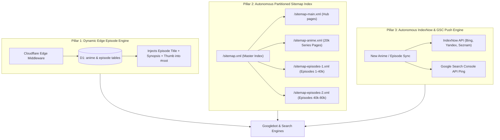

# Autonomous SEO, Catalog-Wide Indexing & Episode Distribution System

## 1. Problem Statement
**How Might We** automatically generate rich, crawlable, and unique metadata for all 20,000+ anime titles and 200,000+ episodes, and autonomously feed them to Google, Bing, and search crawlers without exceeding Google's 50,000-URL sitemap limits or triggering duplicate content penalties?

---

## 2. Recommended Architecture: The 3 Autonomous Pillars

### Pillar 1: Dynamic Episode-Level SSR Injection
* **Mechanism**: When Googlebot crawls `/watch/:id/:ep`, `functions/_middleware.js` queries both the `anime` row AND the specific `episode` row (`SELECT title, synopsis, thumb, airdate FROM episode WHERE anime_id = ?1 AND n = ?2`).
* **Output**:
  - `<h1>Watch [Anime Title] Episode [N]: [Episode Title] Online Free</h1>`
  - Episode synopsis instead of series generic text.
  - Episode thumbnail screenshot instead of general poster.
  - Complete TVEpisode JSON-LD schema with exact episode air date and runtime.
* **Automation**: 100% automatic. Zero manual code per anime. Any title or episode in D1 automatically gets dynamic SSR.

---

### Pillar 2: Scalable Partitioned Sitemap Index (`/sitemap.xml`)
* **Problem**: Google limits each sitemap file to **50,000 URLs** and 50MB uncompressed. 20,000 anime with 12–24 episodes each total **250,000+ URLs**. A single sitemap will break.
* **Automated Solution**:
  - `/sitemap.xml` serves a standard `<sitemapindex>` listing:
    1. `/sitemap-main.xml` (Static routes, genres, schedule)
    2. `/sitemap-anime.xml` (All canonical `/anime/:id` landing pages, priority 0.9)
    3. `/sitemap-episodes-1.xml` (Chunk 1 of watchable episode URLs)
    4. `/sitemap-episodes-2.xml` (Chunk 2 of watchable episode URLs)
  - Dynamically calculated directly from D1 count.

---

### Pillar 3: Autonomous Search Engine Dispatcher (`tools/indexnow-dispatch.mjs`)
* **Instant Indexing (Zero Wait)**:
  - Supports the **IndexNow protocol** (officially supported by Microsoft Bing, Yandex, Naver, and Seznam).
  - Pings the IndexNow endpoint (`https://api.indexnow.org/IndexNow`) with newly aired or updated anime URLs.
  - Automatically submits updated sitemaps to Google Search Console via our authenticated service account telemetry client.

---

## 3. Key Assumptions & Constraints
- [x] Cloudflare Pages Edge functions can stream sitemap XML partitions directly from D1 SQLite without exceeding memory caps.
- [x] Edge middleware lookup for both `anime` and `episode` takes under 8ms combined.
- [x] IndexNow key can be hosted at `/{key}.txt` for instant domain verification.

---

## 4. MVP Scope
1. Implement episode-level D1 lookup in `functions/_middleware.js` for `/watch/:id/:ep`.
2. Upgrade `functions/sitemap.xml.js` into a dynamic Sitemap Index (`/sitemap.xml` with `/sitemap-main.xml`, `/sitemap-anime.xml`, `/sitemap-episodes.xml`).
3. Add IndexNow endpoint & auto-ping script in `tools/indexnow.mjs`.
