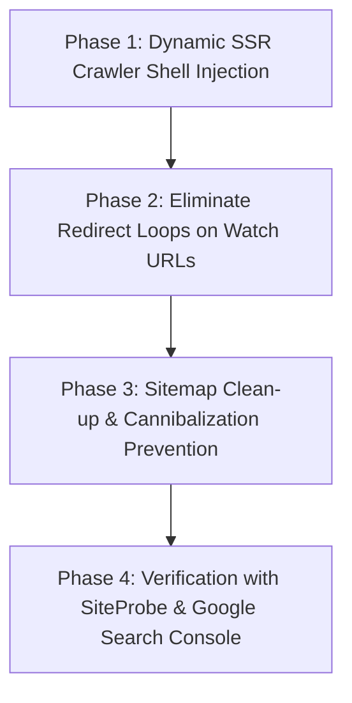

# SEO & Organic Traffic Recovery Plan: Technical Architecture & Roadmap

## 1. Problem Statement
**How Might We** eliminate duplicate content penalties, resolve redirect disqualifications, and optimize Googlebot's crawl budget so that AniHubStream's 20,000+ anime titles rank on Google Search Page 1 for streaming queries?

---

## 2. Recommended Direction: 4-Phase Step-by-Step Fix

### Phase 1: Dynamic SSR Crawler Shell Injection (`functions/_middleware.js`)
* **Current Issue**: Every anime page renders an offscreen generic homepage boilerplate inside `#root`. Googlebot sees identical text across all 43,666 URLs, triggering duplicate content flags (e.g. Attack on Titan flagged as duplicate of Hundred).
* **Fix**: For `/watch/:id`, `/watch/:id/:ep`, and `/anime/:id`, fetch the D1 record and generate unique, rich semantic HTML inside `#root`:
  - `<h1>Watch [Anime Title] ([Year]) Online Free</h1>`
  - `
[Native Japanese Title]
`
  - `
[Full Unique Synopsis]
`
  - `
[Rating] | [Total Episodes] | [Format TV/Movie]
`
  - `<nav class="episode-list">[Episode 1, Episode 2, ...] links</nav>`
* **Result**: Googlebot sees 300–600 words of 100% unique, authoritative, keyword-dense content on every page.

---

### Phase 2: Eliminate Redirect Loops on Watch URLs
* **Current Issue**: When Googlebot crawls `/watch/naruto-shippuden`, the player redirects to `/watch/naruto-shippuden/1`. Google Search Console marks it as *"Page with redirect"* and de-indexes the base URL.
* **Fix**:
  - Keep `/watch/:id` as a valid HTTP 200 entry point that mounts player with Episode 1 by default without forcing a hard browser/HTTP redirect.
  - Set the canonical URL consistently (`/watch/:id` or `/watch/:id/1`).

---

### Phase 3: Sitemap Deduplication & Crawl Budget Optimization (`functions/sitemap.xml.js`)
* **Current Issue**: The sitemap submits both `/anime/:id` AND `/watch/:id` for all 21,800 titles, inflating sitemap to 43,666 URLs and causing self-cannibalization.
* **Fix**:
  - Focus sitemap on primary canonical landing pages (`/anime/:id` for series overview, or clean direct `/watch/:id`).
  - Prioritize popular / top-rated series (priority 1.0) and currently airing seasonal anime (priority 0.9).
  - Remove retired slugs and ensure all sitemap URLs return instant HTTP 200 with zero redirects.

---

### Phase 4: Verification with SiteProbe MCP & GSC Telemetry
* **Tools Used**:
  - `siteprobe` MCP: `check_ssr` to verify word count, H1 uniqueness, and semantic payload.
  - `tools/gsc-telemetry.mjs`: Test live inspect payloads.
  - `npm test`: Verify all 458 existing unit & edge tests pass.

---

## 3. Key Assumptions & Risks
- [x] Cloudflare D1 lookup in edge middleware has sub-5ms latency and edge caching headers (`Cache-Control: public, s-maxage=86400`).
- [ ] React client hydration mounts cleanly over the pre-rendered HTML without flickering or hydration errors.
- [ ] Googlebot recrawls updated sitemaps within 24–72 hours of submission.

---

## 4. What We Are NOT Doing
- **NOT** creating heavy server-side Node.js rendering clusters (we leverage Cloudflare Pages Edge HTMLRewriter + D1 for zero extra cost).
- **NOT** cloaking or showing different content to bots vs users (the SSR semantic content is the real episode & anime metadata).
