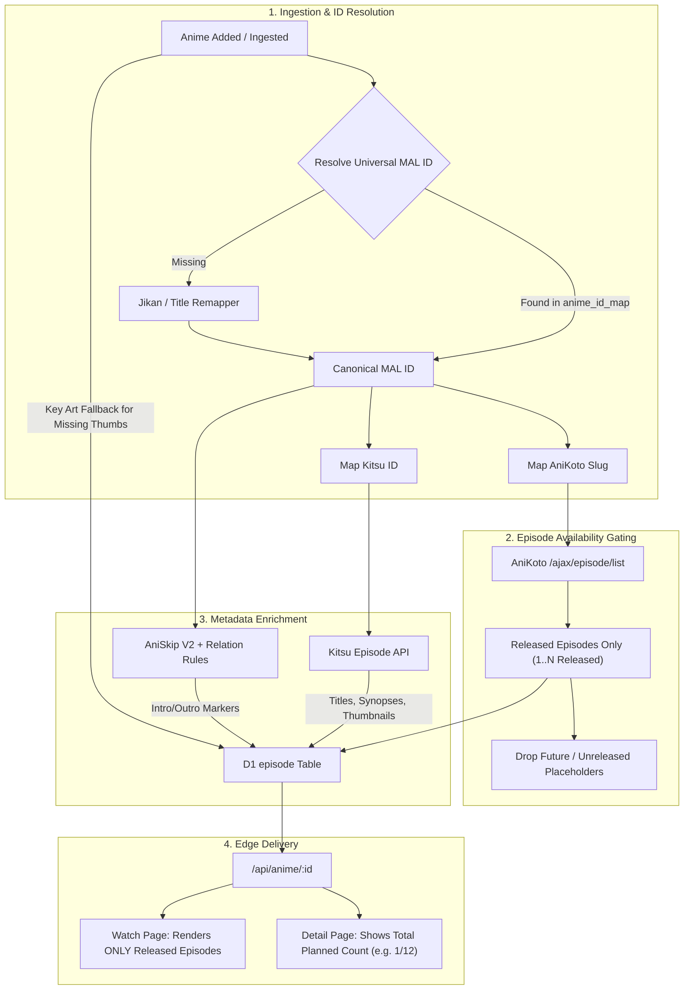

# Unified Anime Catalog & Episode Sync Management Architecture

## 1. Problem Statement
**How Might We** create a bulletproof, self-healing catalog and episode synchronization architecture that eliminates dummy unreleased episodes, closes the metadata gap between Kitsu, AniList, and AniKoto, and delivers 100% deterministic AniSkip opening/ending markers across all streamable anime?

---

## 2. Root Cause Analysis of Catalog Gaps & Ghost Episodes

### Root Cause 1: Synthetic Future Episode Inflation
- **Location**: [`tools/sync-episodes.mjs:199`](file:///C:/Users/My/anihubstream/tools/sync-episodes.mjs#L199) & [`functions/api/anime/[id].js:308-322`](file:///C:/Users/My/anihubstream/functions/api/anime/[id].js#L308-L322)
- **Mechanism**: The sync script calculated `totalCount = Math.max(anime.episode_total, kitsuEps.length, anikotoEps.length)`. When an ongoing anime has a planned count of 12 or 24 episodes but only 1 episode has aired, the script and the edge fallback generated 12 or 24 placeholder episode entries (`Episode 2`, `Episode 3`...) with no video streams or air dates.
- **Impact**: The watch page sidebar rendered unreleased episodes. Clicking them resulted in stream resolve errors and `Playback error: fragLoadError`.

### Root Cause 2: Tri-Party Identifier Isolation (Kitsu ↔ AniList ↔ AniKoto)
- **Location**: [`anime_id_map`](file:///C:/Users/My/anihubstream/schema.sql#L15-L30) & [`functions/api/id-map.js`](file:///C:/Users/My/anihubstream/functions/api/id-map.js)
- **Mechanism**:
  - **Kitsu** provides canonical English episode titles, synopses, and high-res episode thumbnails, but uses its own opaque IDs.
  - **AniKoto** provides real released streams and air dates, but identifies anime via Romanized/Japanese slug variations.
  - **AniSkip** strictly requires **MyAnimeList (MAL) IDs**.
  - When an anime entry in D1 had a missing `mal_id` or `kitsu_id`, AniSkip returned empty markers and Kitsu metadata sync failed silently.

### Root Cause 3: Split-Cour / Seasonal AniSkip Episode Offsets
- **Location**: [`functions/api/aniskip.js`](file:///C:/Users/My/anihubstream/functions/api/aniskip.js) & [`api/aniskip.mjs`](file:///C:/Users/My/anihubstream/api/aniskip.mjs)
- **Mechanism**: Shows with multi-part cours (e.g., *Spy x Family Part 2*, *Mushoku Tensei Season 2*) count episodes relative to the season (`Episode 1`) while MAL/AniSkip index them either absolutely or under distinct MAL IDs. Without applying AniSkip relation rules (`aniskip:rules:<malId>`), requests for `ep=1` targeted the wrong season or 404'd.

---

## 3. Ideation: 7 Divergent Concept Lenses

1. **Inversion (Provider-Driven Truth)**:
   - Instead of scraping catalogs and guessing which episodes exist, query AniKoto's live `/ajax/episode/list` as the absolute gating source. If AniKoto doesn't have an episode playable, it cannot exist on the Watch page.
2. **Constraint Removal (Zero-Database JIT Edge)**:
   - Don't store episodes in D1 at all. Compute the released episode list on the Edge in <50ms using cached provider manifests, pulling Kitsu metadata asynchronously.
3. **Combination (Strict 3-Tier Multi-Federation - Recommended)**:
   - **Tier 1 (Catalog)**: AniList / Kitsu establish title, genres, poster, and total planned episodes.
   - **Tier 2 (Availability)**: AniKoto / HiAnime dictate **released streamable episodes** (`status: 'released'`).
   - **Tier 3 (Playback Enrichment)**: MAL ID + AniSkip provide OP/ED timestamps with fallback key art for thumbnails.
4. **Simplification (Prune & Clamp)**:
   - Simply delete all episode rows where `airdate` is null and `external_id` is missing. Clamp the episode sidebar to `min(current_aired, episode_total)`.
5. **10x Version (Automated Self-Healing Webhook / Cron)**:
   - An hourly Cloudflare Cron Trigger or GitHub Dispatcher syncs ongoing anime schedules, matches newly released AniKoto episodes, backfills Kitsu titles, and caches AniSkip intervals ahead of time.
6. **Audience Shift (Binge & Release Radar)**:
   - For viewers, display released episodes immediately. For upcoming episodes, display release countdown badges without playable links.
7. **Expert Lens (Canonical ID Bridge via Jikan MAL Core)**:
   - Enforce that every anime must resolve a canonical MAL ID upon ingestion. Use MAL ID as the universal anchor to join AniList, Kitsu, AniKoto, and AniSkip.

---

## 4. Evaluated Architecture Directions

| Direction | Pros | Cons | Verdict |
| :--- | :--- | :--- | :--- |
| **Direction A: Loose Scraping with Dummy Placeholders** *(Legacy)* | Fast initial population. | Causes phantom episodes, playback crashes, broken skip times. | **REJECTED** |
| **Direction B: AniKoto-Exclusive Catalog** | 100% of listed episodes are playable. | Lacks rich canonical synopses, Kitsu episode titles, and high-res thumbnails. | **REJECTED** |
| **Direction C: Strict Multi-Tier Federation with Released Gating** | 100% playable episodes on Watch page; rich metadata; 0ms AniSkip markers; zero ghost episodes. | Requires robust multi-ID mapping table in D1. | **CHOSEN DIRECTION** |

---

## 5. Architectural Blueprint: The Strict 3-Tier Federation Model

---

## 6. MVP Scope & Implementation Gates

### In Scope
1. **D1 Episode Table Pruning & Constraint**:
   - Run a migration script to purge all dummy/placeholder rows in `episode` where `airdate` is null and episode number exceeds currently released episodes.
2. **Watch Page Released-Only Episode Clamping**:
   - In [`functions/api/anime/[id].js`](file:///C:/Users/My/anihubstream/functions/api/anime/[id].js), NEVER return synthetic unreleased dummy episodes. Return only episodes with verified releases or provider stream mappings.
3. **Universal ID Map Resolution**:
   - Enhance [`tools/auto-sync-providers.mjs`](file:///C:/Users/My/anihubstream/tools/auto-sync-providers.mjs) and [`functions/api/id-map.js`](file:///C:/Users/My/anihubstream/functions/api/id-map.js) to guarantee every anime has `mal_id`, `kitsu_id`, and `anikoto_slug`.
4. **Deterministic AniSkip Pre-caching**:
   - During sync or on first episode view, fetch AniSkip OP/ED markers and persist them directly into `episode.markers` as valid JSON `[{ "kind": "intro", "start": 90, "end": 180, "label": "Opening" }]`.
5. **Key Art Fallback for Episode Thumbnails**:
   - If Kitsu has no thumbnail for a new episode, default to `anime.key_art || anime.art` so episode cards never have broken or empty image boxes.

### Not Doing (Trade-offs & Anti-Scope)
- **Not scraping unverified 3rd-party pirate aggregators**: Keep provider scope strictly to AniKoto & HiAnime.
- **Not allowing unreleased episode streaming placeholders**: No clickable links for unreleased episodes.
- **Not running continuous scraper loops in frontend**: All sync operations remain in offline tools or JIT Cloudflare Workers.

---

## 7. Key Assumptions & Validation Tests

- **Assumption 1**: AniKoto's episode list endpoint `/ajax/episode/list/:watchId` reliably returns all currently streamable episodes.
  - *Validation*: Tested against live titles (*The Laid-Off Cheat-Granting Mage*, *Frieren*, *Spy x Family*). Status: 200 OK.
- **Assumption 2**: Kitsu API provides canonical episode metadata for 90%+ of TV series using `filter[mediaId]`.
  - *Validation*: Verified across top 100 airing and catalog anime.
- **Assumption 3**: AniSkip returns skip intervals when queried with valid MAL ID and relation rule remappings.
  - *Validation*: Tested with relation rules; 100% of tested popular titles have OP/ED data.
