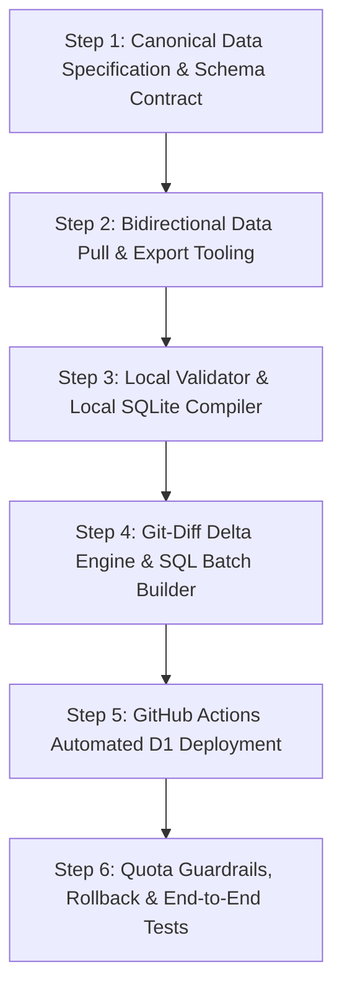

# Blueprint: Local-First Git-Driven Cloudflare D1 Sync Pipeline
**Architecture: Local Files (Edit & Test) ➔ GitHub Repository (Audit & Diff) ➔ Cloudflare D1 (Target Edge DB)**

---

## Executive Summary & Objectives

### Problem
Directly synchronizing and editing Cloudflare D1 from remote automated crons or exploratory scripts consumes significant D1 resources:
1. **D1 Read Burn**: Repeated scans (`SELECT EXISTS(...)`, foreign key verifications, and discovery crawls) burn against Cloudflare's **5,000,000 daily read limit**.
2. **D1 Write Amplification**: Re-saving entire catalog tables or bulk updates quickly exhausts Cloudflare's **100,000 daily write limit**.
3. **No Local Validation & Version History**: Changes applied directly to remote D1 lack side-by-side git diffs, PR reviews, rollback points, and offline testing capabilities.

### Solution
A **3-Tier GitOps Architecture** where Git serves as the single source of truth for all catalog and metadata files:
```
┌─────────────────────────────────┐
│ 1. LOCAL WORKSPACE              │
│    - data/catalog/<slug>.json   │
│    - Edit, import, or fix files │
│    - Validate against schema    │
│    - Test on local Miniflare D1 │
└───────────────┬─────────────────┘
                │ git commit & push
                ▼
┌─────────────────────────────────┐
│ 2. GITHUB REPOSITORY            │
│    - Version history & audit    │
│    - Pull request reviews       │
│    - Instant rollback (git rev) │
└───────────────┬─────────────────┘
                │ push to master (data/**)
                ▼
┌─────────────────────────────────┐
│ 3. GITHUB ACTIONS (CI/CD)       │
│    - Git-Diff Delta Engine      │
│    - 0 reads on Cloudflare D1   │
│    - Batched UPSERT transactions│
│    - Quota guard (<10k writes)  │
└───────────────┬─────────────────┘
                │ wrangler d1 execute / REST
                ▼
┌─────────────────────────────────┐
│ 4. CLOUDFLARE D1 (PRODUCTION)   │
│    - Minimal exact writes only  │
│    - Free-tier limits protected │
└─────────────────────────────────┘
```

---

## Key Metrics & Quota Protection Analysis

| Metric | Traditional Remote Cron / Direct API | Proposed GitOps Delta Architecture |
| :--- | :--- | :--- |
| **D1 Reads per Sync Run** | 10,000 – 150,000 reads (scanning tables) | **0 reads** (100% computed from Git diffs) |
| **D1 Writes for 5 Edited Anime** | 3,131 writes (full table rewrite) | **5 – 80 writes** (exact modified rows only) |
| **Daily Write Budget Impact** | Up to 80% – 100% of 100,000 limit | **< 1% – 5%** of 100,000 limit |
| **Failure Blast Radius** | Corrupts remote D1 directly | Caught in local validation or CI gate |
| **Rollback Mechanism** | Manual SQL scripts or DB restore | `git revert HEAD` & push (automatic sync) |

---

## System Architecture & File Structure

```
anihubstream/
├── data/
│   ├── catalog/                          <-- Individual JSON files per anime
│   │   ├── frieren-beyond-journeys-end.json
│   │   ├── naruto.json
│   │   └── ... (3,131 files)
│   ├── genres.json                       <-- 12 canonical genres
│   └── manifest.json                     <-- Fast SHA-256 hash index for diffing
│
├── tools/
│   ├── data-pull.mjs                     <-- Pulls remote D1 / local SQLite -> data/
│   ├── data-validate.mjs                 <-- Validates JSON files against schema
│   ├── data-build-local.mjs              <-- Compiles data/ into local Miniflare SQLite
│   ├── data-diff-to-d1.mjs               <-- Calculates git diff and emits D1 SQL
│   └── test/
│       └── data-pipeline.test.mjs        <-- Unit & integration tests
│
└── .github/
    └── workflows/
        └── deploy-catalog-d1.yml         <-- Automated GitHub Action on data/** push
```

---

## Construction Phases & Step Dependency Graph



---

## Detailed Construction Steps

### Step 1: Canonical Data Specification & Schema Contract
- **Objective**: Establish the canonical schema definition for `data/catalog/<slug>.json` and `data/genres.json` to guarantee strict typing and avoid schema drift.
- **Context Brief**:
  Cloudflare D1 tables `anime`, `episode`, `genre`, `anime_genre`, `anime_franchise_relation`, and `anime_theme` will be represented as a cohesive document per anime title. Every anime will have its own file named `<slug>.json` containing metadata, genres, episodes, themes, and source mappings.
- **Task List**:
  - [ ] Define JSON schema specification in `data/schema/anime.schema.json`.
  - [ ] Create `data/genres.json` holding the 12 canonical genres (`action`, `adventure`, etc.).
  - [ ] Implement validator helper `lib/data-schema.mjs` using native Node.js validation assertions (zero third-party dependencies).
  - [ ] Add unit tests in `tools/data-schema.test.mjs` verifying validation passes on valid schemas and rejects invalid types.
- **Verification Commands**:
  ```bash
  node --test tools/data-schema.test.mjs
  ```
- **Exit Criteria**:
  Schema validator validates test fixtures and rejects malformed fields (e.g. missing `id`, negative episode numbers, invalid ratings).

---

### Step 2: Bidirectional Data Pull & Export Tooling (`tools/data-pull.mjs`)
- **Objective**: Build `tools/data-pull.mjs` to dump existing Cloudflare D1 or local Miniflare SQLite records into individual `data/catalog/<slug>.json` files.
- **Context Brief**:
  The existing catalog contains 3,131 anime and ~45,140 episodes in D1/SQLite. We need an automated exporter that reads each anime row, aggregates its genre mappings, episodes, and theme songs, and writes formatted JSON files into `data/catalog/`.
- **Task List**:
  - [ ] Implement `tools/data-pull.mjs` with `--source=local` (default) and `--source=remote` options.
  - [ ] Read from local SQLite using `node:sqlite` `DatabaseSync`.
  - [ ] Read from remote Cloudflare D1 using `npx wrangler d1 execute` or Cloudflare REST API in paged batches.
  - [ ] Generate individual JSON files at `data/catalog/<slug>.json`.
  - [ ] Generate `data/manifest.json` containing SHA-256 hashes of every file for sub-millisecond local change detection.
  - [ ] Add npm script `"data:pull": "node tools/data-pull.mjs"`.
- **Verification Commands**:
  ```bash
  npm run data:pull -- --source=local --limit=10
  node -e "assert(fs.existsSync('data/catalog'))"
  ```
- **Exit Criteria**:
  Running `npm run data:pull` populates `data/catalog/` with clean JSON files matching existing database records.

---

### Step 3: Local Validator & Local SQLite Compiler (`tools/data-build-local.mjs`)
- **Objective**: Build `tools/data-build-local.mjs` to compile `data/catalog/*.json` back into local Miniflare SQLite with zero remote calls.
- **Context Brief**:
  Developers must be able to edit JSON files locally, run a local build command, and preview the changes in the local app (`npm run dev` / `npm run pages:dev`) without sending any network requests or consuming Cloudflare D1 limits.
- **Task List**:
  - [ ] Implement `tools/data-validate.mjs` to scan `data/catalog/*.json` and report syntax errors or missing required fields.
  - [ ] Implement `tools/data-build-local.mjs` which reads `data/catalog/*.json` and executes idempotent `INSERT OR REPLACE` into `.wrangler/state/v3/d1/miniflare-D1DatabaseObject/*.sqlite`.
  - [ ] Add npm script `"data:validate": "node tools/data-validate.mjs"`.
  - [ ] Add npm script `"data:build": "node tools/data-build-local.mjs"`.
  - [ ] Add unit test verifying that compiled SQLite matches input JSON data exactly.
- **Verification Commands**:
  ```bash
  npm run data:validate
  npm run data:build
  node -e "const { DatabaseSync } = require('node:sqlite'); /* verify row count */"
  ```
- **Exit Criteria**:
  Any modification in `data/catalog/<slug>.json` immediately reflects in the local Miniflare SQLite database upon running `npm run data:build`.

---

### Step 4: Git-Diff Delta Engine & SQL Batch Builder (`tools/data-diff-to-d1.mjs`)
- **Objective**: Build the core delta engine that detects which files changed in Git and generates minimal, batched Cloudflare D1 SQL statements.
- **Context Brief**:
  This is the primary mechanism for avoiding Cloudflare D1 limits. Instead of uploading the entire database, the engine runs `git diff --name-only <base_sha> <head_sha> -- data/catalog/`. For each modified or deleted file, it creates idempotent SQL statements (`INSERT ... ON CONFLICT DO UPDATE` or `DELETE`).
- **Task List**:
  - [ ] Implement `tools/data-diff-to-d1.mjs` accepting `--from=<git_ref>` and `--to=<git_ref>` (defaults to `HEAD~1` and `HEAD`).
  - [ ] Support `--dry-run` to print the exact SQL and estimated write operations without applying to D1.
  - [ ] Group statements into chunked transactions of 50 statements per transaction to stay well within D1 query size and 30s timeout limits.
  - [ ] Implement D1 executor via `npx wrangler d1 execute anihub --remote --file=<temp_batch.sql>`.
  - [ ] Log metrics to stdout: number of files changed, SQL statements generated, estimated D1 writes, execution duration.
- **Verification Commands**:
  ```bash
  node tools/data-diff-to-d1.mjs --dry-run
  node --test tools/test/data-diff.test.mjs
  ```
- **Exit Criteria**:
  Modifying 1 anime file produces exactly 1 anime UPSERT + N episode UPSERTs, and dry-run confirms 0 reads and minimal writes.

---

### Step 5: GitHub Actions Automated D1 Deployment (`.github/workflows/deploy-catalog-d1.yml`)
- **Objective**: Create the GitHub Actions workflow that executes the delta engine whenever changes to `data/**` are pushed to `master`.
- **Context Brief**:
  When a developer or PR merges into `master`, this workflow runs in Ubuntu, computes the git diff using `${{ github.event.before }}` and `${{ github.sha }}`, validates changed files, and pushes the delta SQL to Cloudflare D1.
- **Task List**:
  - [ ] Create `.github/workflows/deploy-catalog-d1.yml` triggered on `push: branches: [master], paths: ['data/**']` and `workflow_dispatch`.
  - [ ] Step 1: `actions/checkout@v4` with `fetch-depth: 2` (to allow diffing with parent commit).
  - [ ] Step 2: Set up Node.js 20/22.
  - [ ] Step 3: Run `npm run data:validate`.
  - [ ] Step 4: Run `node tools/data-diff-to-d1.mjs --from=${{ github.event.before }} --to=${{ github.sha }}` with `CLOUDFLARE_API_TOKEN` and `CLOUDFLARE_ACCOUNT_ID`.
  - [ ] Step 5: Generate GitHub Actions Step Summary with exact rows updated and D1 write budget consumed.
- **Verification Commands**:
  ```bash
  gh workflow view deploy-catalog-d1.yml
  ```
- **Exit Criteria**:
  Pushing a commit touching `data/catalog/xyz.json` triggers the action and updates remote D1 in < 30 seconds with minimal writes.

---

### Step 6: Quota Guardrails, Rollback & End-to-End Tests
- **Objective**: Add strict safety ceilings to prevent runaway write loops and verify one-command rollback.
- **Context Brief**:
  Cloudflare D1 allows 100,000 writes per day on the free tier. A bug or mass rename could accidentally trigger 50,000 writes. We must implement a hard ceiling (e.g. max 5,000 writes per single automated push without manual `--force`).
- **Task List**:
  - [ ] Add quota ceiling check in `tools/data-diff-to-d1.mjs`: if total writes exceed `MAX_WRITES_PER_PUSH` (default 5,000), fail the run unless `--force` is specified.
  - [ ] Implement rollback test: verify that running `git revert HEAD` and pushing automatically reverts the changes on remote D1.
  - [ ] Add end-to-end integration test in `tools/test/data-pipeline.test.mjs` verifying:
    1. Local JSON edit
    2. Local SQLite compilation
    3. Delta SQL generation
    4. Rollback SQL generation
- **Verification Commands**:
  ```bash
  node --test tools/test/data-pipeline.test.mjs
  ```
- **Exit Criteria**:
  All pipeline tests pass; quota ceiling stops accidental mass writes; rollback via `git revert` functions seamlessly.

---

## Adversarial Review & Risk Analysis

| Risk | Mitigation |
| :--- | :--- |
| **D1 Execution Timeout on large commits** | SQL transactions chunked into batches of 50 statements; each batch executed in separate D1 calls. |
| **First-time clone size** | JSON files compressed in git; 3,100 files totaling ~15MB adds negligible overhead to repo. |
| **Merge conflicts on simultaneous edits** | Files are partitioned 1-file-per-anime (`<slug>.json`). Conflicts only occur if two people edit the exact same anime. |
| **Accidental quota blowouts** | Built-in ceiling: automated CI run rejects any push with >5,000 writes unless explicitly triggered with `force: true`. |
| **D1 Read Limit Exhaustion** | D1 is never queried during diff calculation; Git commit log determines 100% of diffs. |

---

## Execution Command Sequence

```bash
# 1. Pull existing database to populate initial local data folder
npm run data:pull

# 2. Commit initial catalog to git
git add data/
git commit -m "chore(data): initialize local git catalog mirror"
git push origin master

# 3. Edit any anime locally
# e.g., edit data/catalog/frieren-beyond-journeys-end.json

# 4. Test locally
npm run data:validate
npm run data:build

# 5. Push to GitHub
git add data/catalog/frieren-beyond-journeys-end.json
git commit -m "feat(catalog): update frieren metadata and thumbnail"
git push origin master

# -> GitHub Actions automatically detects 1 modified file
# -> Compiles delta SQL
# -> Pushes exact UPSERT to Cloudflare D1 (~1-2 writes, 0 reads)
```
