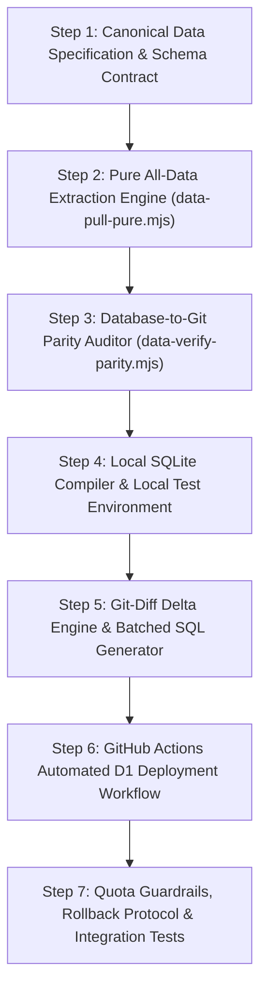

# Blueprint: Pure 1:1 Data Mirror & Local-First GitOps Cloudflare D1 Sync Pipeline
**Architecture: Pure Complete Data Mirror in GitHub & Cloudflare D1 + Local Editing + Zero-Read Delta Deployment**

---

## Executive Summary & Objectives

### The Goal
Establish a **100% pure complete copy of all data** in both **Cloudflare D1** and the **GitHub Repository**, coupled with a local-first GitOps workflow:
1. **Pure All Data Parity**: GitHub holds the full, uncompressed, uncorrupted source of truth for **all database tables** (anime, episodes, genres, franchise relations, themes, ID cross-references, provider routes, and redirects). Anyone cloning the repo gets a 100% working, identical database replica locally.
2. **Cloudflare D1 Quota Shield**:
   - **Zero reads on D1** during sync: Diff calculation is 100% computed from Git history in GitHub Actions.
   - **Minimal exact writes**: Editing files locally only updates the changed records in D1.
   - **Avoid D1 Free-Tier Limits**: Keeps daily operations within Cloudflare's **100,000 writes/day** and **5,000,000 reads/day** thresholds.
3. **Local Editing with Instant Preview**: Edit anime or metadata locally, test on local Miniflare SQLite, commit to GitHub, and let GitHub Actions push the minimal delta to Cloudflare D1.

```
┌────────────────────────────────────────────────────────┐
│ 1. LOCAL WORKSPACE                                     │
│    - data/catalog/<slug>.json  (All 3,131 Anime Docs)  │
│    - data/reference/*.json     (Genres, Routes, Maps)  │
│    - Edit, test, and preview locally on Miniflare D1   │
└───────────────────────────┬────────────────────────────┘
                            │ git commit & push
                            ▼
┌────────────────────────────────────────────────────────┐
│ 2. GITHUB REPOSITORY (100% PURE COMPLETE DATA MIRROR)   │
│    - 1:1 Pure copy of all Cloudflare D1 tables         │
│    - Full Git audit log, PR reviews, & blame history   │
│    - Instant rollback (git revert)                     │
└───────────────────────────┬────────────────────────────┘
                            │ push to master (data/**)
                            ▼
┌────────────────────────────────────────────────────────┐
│ 3. GITHUB ACTIONS (DELTA & PARITY ENGINE)              │
│    - Computes git diff (0 reads on Cloudflare D1)      │
│    - Generates chunked atomic SQL UPSERT batches       │
│    - Quota guard (<5,000 writes per push ceiling)      │
└───────────────────────────┬────────────────────────────┘
                            │ wrangler d1 execute / REST
                            ▼
┌────────────────────────────────────────────────────────┐
│ 4. CLOUDFLARE D1 (PRODUCTION EDGE DATABASE)            │
│    - 1:1 Parity with GitHub Repository                 │
│    - Exact writes only (leaves 95%+ quota free)        │
└────────────────────────────────────────────────────────┘
```

---

## Scope of "Pure All Data" (Complete D1 Schema Coverage)

The system mirrors **100% of all catalog and reference tables** between Cloudflare D1 and GitHub:

| Table | Live Count | Description | Storage in GitHub (`data/`) |
| :--- | :--- | :--- | :--- |
| `anime` | 3,131 rows | Canonical anime titles, art, ratings, synopsis, air schedules | `data/catalog/<slug>.json` |
| `episode` | 45,143 rows | All episode thumbnails, runtimes, titles, air dates, markers | `data/catalog/<slug>.json` (`episodes: []`) |
| `genre` | 12 rows | Canonical genres (Action, Sci-Fi, Romance, etc.) | `data/reference/genres.json` |
| `anime_genre` | ~12,500 rows | Many-to-many anime to genre links | `data/catalog/<slug>.json` (`genres: []`) |
| `anime_franchise_relation`| 1,480+ rows | Graph of sequels, prequels, spin-offs, side stories | `data/reference/franchise_relations.json` |
| `anime_theme` | ~4,200 rows | Openings (OP) and Endings (ED) song metadata | `data/catalog/<slug>.json` (`themes: []`) |
| `anime_id_map` | 2,788+ rows | Universal ID cross-references (MAL, AniList, Kitsu, AniDB) | `data/reference/id_map.json` |
| `provider_route` | 20+ rows | Dynamic streaming route resolution rules | `data/reference/provider_routes.json` |
| `anime_redirect` | ~50 rows | Slug aliases and 301 canonical redirects | `data/reference/redirects.json` |

*(Note: Ephemeral user tables like `viewer`, `library`, `position`, and `stream_cache` remain live on Cloudflare D1 and are not tracked in git).*

---

## Directory & File Structure in GitHub

```
anihubstream/
├── data/
│   ├── catalog/                          <-- 100% Pure copy of all anime + episodes
│   │   ├── frieren-beyond-journeys-end.json
│   │   ├── fullmetal-alchemist-brotherhood.json
│   │   ├── naruto-shippuden.json
│   │   └── ... (3,131 individual JSON files)
│   │
│   ├── reference/                        <-- Pure copy of relational & routing tables
│   │   ├── genres.json                   <-- 12 canonical genres
│   │   ├── franchise_relations.json      <-- 1,480+ franchise graph edges
│   │   ├── id_map.json                   <-- Universal cross-provider ID mapping
│   │   ├── provider_routes.json          <-- Video routing rules & edge overrides
│   │   └── redirects.json                <-- Slug alias mapping
│   │
│   ├── schema/
│   │   └── anime.schema.json             <-- JSON Schema definition for validation
│   └── manifest.json                     <-- SHA-256 integrity hash for fast parity audits
│
├── tools/
│   ├── data-pull-pure.mjs                <-- Extracts 100% pure data from D1 -> data/
│   ├── data-verify-parity.mjs            <-- Audit engine comparing D1 vs GitHub parity
│   ├── data-validate.mjs                 <-- Schema validator for local data files
│   ├── data-build-local.mjs              <-- Rebuilds local Miniflare SQLite from data/
│   ├── data-diff-to-d1.mjs               <-- Calculates Git diff & emits D1 batch SQL
│   └── test/
│       └── data-pipeline.test.mjs        <-- Unit and integration test suite
│
└── .github/
    └── workflows/
        ├── deploy-catalog-d1.yml         <-- Runs on push to data/** (Delta deploy to D1)
        └── parity-audit.yml              <-- Weekly scheduled D1 vs GitHub integrity check
```

---

## Construction Phases & Step Dependency Graph



---

## Detailed Construction Steps

### Step 1: Canonical Data Specification & Schema Contract
- **Objective**: Define strict schema contracts for `data/catalog/<slug>.json` and all reference files in `data/reference/`.
- **Context Brief**:
  To guarantee that data in GitHub is 100% pure and convertible to SQL without loss of fidelity, every JSON file must adhere to explicit contracts. An anime JSON document encapsulates the anime row, its genres, its episode array, its themes, and its external IDs.
- **Task List**:
  - [ ] Create `data/schema/anime.schema.json` validating anime metadata, episode arrays, and themes.
  - [ ] Implement `lib/data-schema.mjs` using native Node.js validation assertions.
  - [ ] Create test fixtures in `tools/test/fixtures/` and unit test `tools/data-schema.test.mjs`.
- **Verification Commands**:
  ```bash
  node --test tools/data-schema.test.mjs
  ```
- **Exit Criteria**:
  Schema validator verifies valid documents and rejects missing IDs, invalid status values, or malformed episode arrays.

---

### Step 2: Pure All-Data Extraction Engine (`tools/data-pull-pure.mjs`)
- **Objective**: Extract 100% pure data from Cloudflare D1 (or local SQLite) into `data/catalog/` and `data/reference/`.
- **Context Brief**:
  Cloudflare D1 holds 3,131 anime, 45,143 episodes, and thousands of relations. Querying all 45,000 episodes in a single query fails due to D1 size and timeout limits. This tool uses chunked keyset pagination to pull pure data cleanly without timeout or memory exhaustion.
- **Task List**:
  - [ ] Implement `tools/data-pull-pure.mjs` supporting `--source=remote` and `--source=local`.
  - [ ] Extract reference tables: `genre` -> `data/reference/genres.json`, `provider_route` -> `data/reference/provider_routes.json`, `anime_franchise_relation` -> `data/reference/franchise_relations.json`, `anime_id_map` -> `data/reference/id_map.json`, `anime_redirect` -> `data/reference/redirects.json`.
  - [ ] Extract all 3,131 anime and join episodes, genres, and themes into `data/catalog/<slug>.json` using chunked queries (100 anime per chunk).
  - [ ] Generate `data/manifest.json` with SHA-256 checksums of all exported files.
  - [ ] Add npm script `"data:pull-pure": "node tools/data-pull-pure.mjs"`.
- **Verification Commands**:
  ```bash
  npm run data:pull-pure -- --source=local --limit=20
  node -e "assert(fs.existsSync('data/catalog') && fs.existsSync('data/reference/genres.json'))"
  ```
- **Exit Criteria**:
  Tool extracts 100% of data with 0 missing rows and writes cleanly formatted JSON files.

---

### Step 3: Database-to-Git Parity Auditor (`tools/data-verify-parity.mjs`)
- **Objective**: Create an automated parity verification tool to prove that the GitHub folder copy is 100% identical to Cloudflare D1.
- **Context Brief**:
  To confirm that the copy in GitHub is "pure", this tool checks:
  1. Total row count parity across all tables.
  2. Primary key set equality (no missing or orphan slugs).
  3. Sample row deep-equality between JSON and D1.
- **Task List**:
  - [ ] Implement `tools/data-verify-parity.mjs` to compare D1 row counts against files in `data/`.
  - [ ] Produce a clean parity report showing count diffs, missing slugs, and integrity status.
  - [ ] Add npm script `"data:verify-parity": "node tools/data-verify-parity.mjs"`.
- **Verification Commands**:
  ```bash
  npm run data:verify-parity
  ```
- **Exit Criteria**:
  Parity audit outputs `Status: 100% PARITY (0 mismatches)` across all tables.

---

### Step 4: Local SQLite Compiler & Local Test Environment (`tools/data-build-local.mjs`)
- **Objective**: Build local database compiler that rebuilds `.wrangler/state/v3/d1/.../*.sqlite` entirely from GitHub's `data/` folder.
- **Context Brief**:
  Allows any developer to clone the GitHub repo, run one command, and have a fully seeded local database with 3,131 anime and 45,000 episodes ready for `npm run dev` with ZERO calls to Cloudflare.
- **Task List**:
  - [ ] Implement `tools/data-build-local.mjs` using `node:sqlite` `DatabaseSync`.
  - [ ] Execute `schema.sql` to initialize local SQLite tables.
  - [ ] Read `data/reference/*.json` and bulk-insert reference rows.
  - [ ] Read `data/catalog/*.json` and bulk-insert anime, episodes, genres, and themes in transactions of 500 rows.
  - [ ] Add npm script `"data:build": "node tools/data-build-local.mjs"`.
- **Verification Commands**:
  ```bash
  npm run data:build
  node -e "const { DatabaseSync } = require('node:sqlite'); /* verify local counts match */"
  ```
- **Exit Criteria**:
  Local Miniflare SQLite is 100% populated from `data/` and UI functions identically to production.

---

### Step 5: Git-Diff Delta Engine & Batched SQL Generator (`tools/data-diff-to-d1.mjs`)
- **Objective**: Compute Git diffs between commits and emit minimal, chunked D1 SQL statements.
- **Context Brief**:
  Instead of rewriting the entire database, this engine identifies exactly which files changed:
  - If `data/catalog/frieren.json` changed -> generate UPSERT for `frieren` and its episodes.
  - If `data/reference/genres.json` changed -> generate UPSERT for modified genres.
  - If a file is deleted -> generate soft/hard DELETE for that anime.
  - Statements are chunked into 50 statements per transaction to stay within D1 limits.
- **Task List**:
  - [ ] Implement `tools/data-diff-to-d1.mjs` with `--from=<sha>` and `--to=<sha>` (default `HEAD~1` to `HEAD`).
  - [ ] Implement `--dry-run` to preview generated SQL and estimated write operations.
  - [ ] Chunk transactions into 50 statements per batch.
  - [ ] Execute via `npx wrangler d1 execute anihub --remote --file=<batch.sql>`.
- **Verification Commands**:
  ```bash
  node tools/data-diff-to-d1.mjs --dry-run
  node --test tools/test/data-diff.test.mjs
  ```
- **Exit Criteria**:
  Editing 1 file emits only the SQL for that 1 file; zero untouched rows are written.

---

### Step 6: GitHub Actions Automated D1 Deployment (`.github/workflows/deploy-catalog-d1.yml`)
- **Objective**: Continuous deployment workflow that pushes data updates to Cloudflare D1 whenever commits touch `data/**`.
- **Context Brief**:
  Runs in CI when a commit or PR is merged into `master`. Computes git diff, validates schema, applies delta SQL to Cloudflare D1, and logs remaining D1 quota.
- **Task List**:
  - [ ] Create `.github/workflows/deploy-catalog-d1.yml` on push to `data/**`.
  - [ ] Step 1: `actions/checkout@v4` with `fetch-depth: 2`.
  - [ ] Step 2: Validate modified files with `node tools/data-validate.mjs`.
  - [ ] Step 3: Run `node tools/data-diff-to-d1.mjs --from=${{ github.event.before }} --to=${{ github.sha }}` using `CLOUDFLARE_API_TOKEN`.
  - [ ] Step 4: Output summary of rows updated and writes consumed in GitHub Actions Step Summary.
- **Verification Commands**:
  ```bash
  gh workflow view deploy-catalog-d1.yml
  ```
- **Exit Criteria**:
  Pushing a modified JSON file to GitHub deploys to Cloudflare D1 within 30 seconds with 0 reads and minimal writes.

---

### Step 7: Quota Guardrails, Rollback Protocol & Integration Tests
- **Objective**: Enforce safety limits to protect Cloudflare D1 free-tier limits and test instant rollback.
- **Context Brief**:
  Prevent human or automated errors from accidentally rewriting thousands of rows.
- **Task List**:
  - [ ] Add quota ceiling: abort if a single push generates >5,000 writes unless `--force` is set.
  - [ ] Implement rollback test: verify that `git revert HEAD` reverses changes on Cloudflare D1.
  - [ ] Add end-to-end integration test in `tools/test/data-pipeline.test.mjs`.
- **Verification Commands**:
  ```bash
  node --test tools/test/data-pipeline.test.mjs
  ```
- **Exit Criteria**:
  Pipeline tests pass; quota guard stops excessive writes; `git revert` cleanly rolls back D1 changes.

---

## Adversarial Review & Safeguards

| Risk | Mitigation |
| :--- | :--- |
| **D1 Timeout during initial full export** | `tools/data-pull-pure.mjs` uses keyset pagination in chunks of 100 anime, avoiding memory and query execution limits. |
| **Data Drift between D1 and GitHub** | Weekly automated audit workflow (`parity-audit.yml`) verifies checksum parity between D1 and Git. |
| **Accidental Quota Burn** | 5,000 write hard ceiling on CI runs stops runaway scripts or mass accidents. |
| **Zero D1 Read Burn** | Git commit diff computes 100% of change sets. Cloudflare D1 is never scanned during sync. |
| **Git Clone Overhead** | Storing 3,131 individual JSON files totals ~15MB, which is lightweight for Git and avoids merge conflict collisions. |

---

## Execution Command Sequence

```bash
# 1. Extract 100% pure data from Cloudflare D1 into GitHub data/ folder
npm run data:pull-pure -- --source=remote

# 2. Verify 100% parity
npm run data:verify-parity

# 3. Commit pure data copy to GitHub (initial baseline)
git add data/
git commit -m "chore(data): initialize 100% pure complete data mirror in github"
git push origin master

# 4. Routine editing: edit any anime or reference file locally
# e.g., edit data/catalog/frieren-beyond-journeys-end.json

# 5. Test locally on Miniflare SQLite (0 Cloudflare API calls)
npm run data:validate
npm run data:build

# 6. Push to GitHub
git add data/catalog/frieren-beyond-journeys-end.json
git commit -m "feat(catalog): update frieren episode metadata"
git push origin master

# -> GitHub Action computes diff
# -> Applies exact UPSERT to Cloudflare D1 (0 reads, ~2 writes)
# -> Pure 1:1 parity maintained in both GitHub and Cloudflare D1!
```
